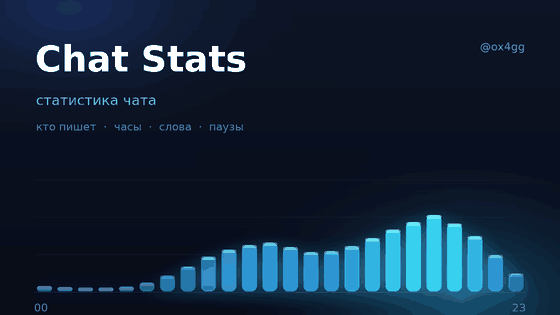

# Chat Stats



Плагин для exteraGram: статистика чата и выгрузка переписки в zip. Всё считается на телефоне.

## Статистика

Открывается из меню чата — три точки, «Статистика чата».

- кто сколько написал, с процентом и полоской
- активность по часам и по дням недели
- самые частые слова
- самые длинные паузы: сколько тишина длилась, когда закончилась и кто её нарушил
- сводка: сообщения, участники, период, доля медиа, средняя длина сообщения

Топ слов считается по самому чату, словаря внутри нет. Плагин проходит всю переписку, считает частоту каждого слова и отдельно — в скольких сообщениях оно встречается. Слова, которые есть почти в каждом сообщении («что», «это», «как» и прочая механика), отсеиваются как филлеры, остаются те, что действительно в ходу именно здесь. Фильтр можно выключить в настройках и посмотреть сырой топ. Свои стоп-слова тоже задаются вручную.

## Экспорт в zip

Настройки плагина → «Экспорт чата в zip».

Дальше два пути: вписать `@username` или ссылку `t.me/…`, либо нажать «Мои чаты» и выбрать из последних диалогов. Потом выбрать глубину — от 1 000 сообщений до всей истории. Плагин качает переписку, собирает архив и отправляет его в «Избранное».

Внутри архива:

- `chat.txt` — читаемая переписка, строка на сообщение
- `chat.csv` — id, дата, автор, тип, текст
- `chat.json` — то же самое структурой
- `stats.txt` — та же статистика, посчитанная по всей выгруженной переписке

Приватные ссылки-приглашения (`t.me/+…`) не поддерживаются — нужен публичный юзернейм или выбор из списка чатов.

## Установка

[Скачать chat_stats.plugin](https://github.com/Korimuspast1/frd/raw/main/plugins/chat_stats/chat_stats.plugin) и открыть файл в exteraGram — приложение само предложит установить.

Или добавить репозиторий в каталоге плагинов:

```
https://github.com/Korimuspast1/frd
```

Для установки из репозитория в настройках плагинов должен быть включён пункт про неизвестные источники.

Требования: exteraGram 12.5.1 и новее, SDK 1.4.4.3 и новее.

## Настройки

- **Сколько сообщений читать** — от 300 до 10 000 или вся история. Чем глубже, тем точнее и тем дольше счёт.
- **Пропускать служебные** — заходы, пины, смены названия и прочая механика не попадают в статистику.
- **Убирать слова-филлеры** — автофильтр заезженных слов, считается по конкретному чату.
- **Свои стоп-слова** — через запятую.
- **Показывать обложку** — та самая гифка в настройках.

## Сборка

```bash
python3 tools/make_cover.py    # assets/cover.gif и assets/cover.png
python3 tools/build_plugin.py  # plugins/chat_stats/chat_stats.plugin
python3 tools/build_index.py   # extera-plugins.json
```

`plugin/chat_stats.py` — исходник. Обложка вшивается в `.plugin` при сборке, поэтому готовый файл весит около 380 КБ.

## Изменения

- **1.1.1** — чтение истории больше не может висеть вечно: если Telegram молчит 30 секунд, загрузка обрывается с понятным сообщением, а ошибки обработки страницы показываются, а не проглатываются. Процент теперь считается от скачанных сообщений.
- **1.1.0** — экспорт переписки в zip, топ слов без встроенного словаря.
- **1.0.0** — первый релиз: статистика, паузы, обложка.

## Автор

[@ox4gg](https://t.me/ox4gg)
