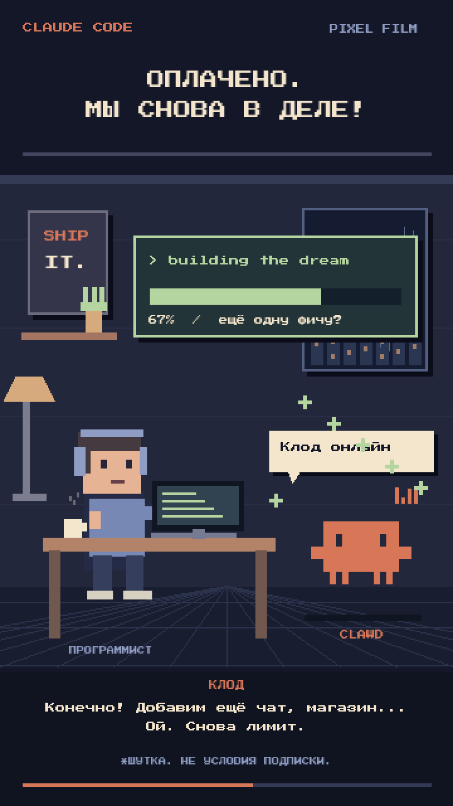

# Claude Code — «Купил надежду»

Неофициальная юмористическая пиксельная анимация: программист и Clawd,
покупка подписки, короткий прилив продуктивности и новый лимит.

## Смотреть

[](exports/claude-code-pixel-40s-voiced.mp4)

- **[Видео со встроенным звуком — MP4](exports/claude-code-pixel-40s-voiced.mp4)**
- [Полная звуковая дорожка отдельно — MP3](exports/soundtrack-40s-voiced.mp3)
- 40 секунд, 720 × 1280, 9:16, 30 fps.
- H.264 / AAC, стерео, faststart.

## Полная переработка

Вместо выдуманного круглого маскота используется силуэт **Clawd** из
официального терминального приветствия Claude Code. Блочные символы
переведены в пиксельную маску с сохранением четырёх ножек, глаз,
пропорций терминальных ячеек и терракотового цвета `#d77757`.
[Источник и описание референса](assets/clawd-reference.txt).

Новая сцена — комната с дождливым окном, рабочим столом, программистом и
Clawd рядом. В кадре анимированы набор текста, пар от кружки, дождь,
персонаж, курсор оплаты, конфетти и ход сборки проекта. Русские субтитры и два разных синтезированных голоса озвучивают диалог.
Восемь реплик распределены по таймлайну без пересечений; музыка и эффекты
автоматически становятся тише во время речи.

- [Субтитры SRT](exports/dialogue-40s.srt)
- [Тайминг реплик JSON](exports/dialogue-40s.json)
- Исходные выбранные голоса сохранены в `assets/voices/`.
- [Предыдущая версия, 25 секунд без озвучки](exports/claude-code-pixel-25s.mp4).

## Звук

Звук **уже встроен в MP4**, его не нужно добавлять отдельно.
Музыка и эффекты синтезируются кодом, без скачанных аудиосэмплов:

- оригинальная чиптюн-мелодия, бас и ударные;
- клавиши механической клавиатуры и щелчки мыши;
- каскад монет при оплате (16,75 с);
- звук ускорения (18 с);
- сигнал лимита и нисходящее выключение (9,5 и 27 с);
- финальный джингл и синтетическое посапывание.

## Повторная генерация

```bash
python -m venv .venv
.venv/bin/pip install -r requirements.txt
.venv/bin/python tools/make_video.py
.venv/bin/python tools/check_video.py
```

FFmpeg поставляется через `imageio-ffmpeg`. Исходная озвучка включена в репозиторий; повторный рендер не требует API озвучки.
Рендер детерминированный;
временный WAV не включается в Git. Шрифт Press Start 2P распространяется
по SIL OFL, текст лицензии находится в `assets/FONT-LICENSE.txt`.

Персонаж и название Claude принадлежат соответствующим правообладателям.
Ролик не является официальной рекламой; реплики о лимитах — шутка,
а не описание условий подписки. Файлы MP4 и EXE в корне репозитория
существовали до этой работы и не используются при генерации.
