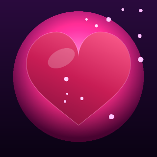
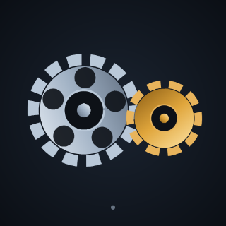
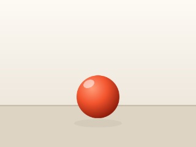
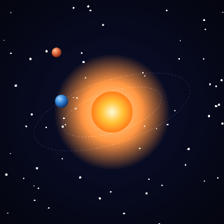
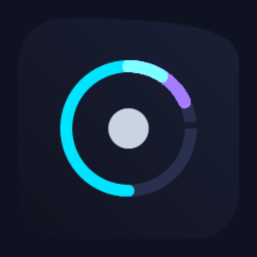
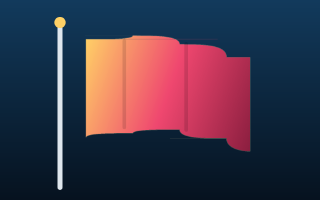

# KVS — Korium Vector Sequence 🎞️

**Собственный формат файла векторной анимации** (`.kvs`) **и два движка**, которые
умеют его расшифровывать и выдавать картинку: программный растеризатор на чистом
Python и интерактивный веб-плеер на Canvas2D. Никаких заимствованных библиотек:
контейнер, сцена, растеризатор, PNG/GIF/APNG-кодеры и LZW написаны с нуля.

Идея близка `.tgs` (стикеры Telegram): крошечный файл, внутри — вектор и ключевые
кадры, масштабируется без потерь. Но байты, схема сцены, easing-набор, иерархия
слоёв и оба рендерера — полностью наши.

| [heart](examples/heart.kvs) | [gears](examples/gears.kvs) | [ball](examples/ball.kvs) |
|:---:|:---:|:---:|
|  |  |  |
| [orbit](examples/orbit.kvs) | [spinner](examples/spinner.kvs) | [flag](examples/flag.kvs) |
|  |  |  |

## Возможности

* **Контейнер**: 32-байтовый заголовок (магия `KVS\x1E`, версия, fps Q8.8, CRC-32),
  сжатие `zlib / gzip / lzma / raw`, вшитое PNG-превью первого кадра.
* **Сцена**: слои с иерархией (parent), геометрия (path/rect/round-rect/ellipse/
  circle/polygon/star), **морфинг контуров**, заливка и обводка (cap/join/miter/
  dash), градиенты linear/radial/conic, blend-режимы (multiply, screen, overlay, add),
  34 easing-кривые + произвольные кривые Безье + `hold`-ключи.
* **Python-движок** (`kvs/`): сканлайн-растеризатор с суперсэмплингом и
  сглаживанием, собственные кодеры PNG/APNG/GIF; CLI `tools/kvsc.py`.
* **Веб-движок** (`viewer/`): плеер-студия в браузере — галерея, drag&drop,
  перемотка, инспектор сцены; распаковка через `DecompressionStream`.
* **Тесты** (`tests/`): 24 проверки, включая кросс-сверку Python ↔ JS.

## Быстрый старт

```bash
# 1. посмотреть, что внутри файла
python3 tools/kvsc.py inspect examples/heart.kvs

# 2. отрисовать кадр в PNG
python3 tools/kvsc.py render examples/heart.kvs -o frame.png --frame 22

# 3. экспортировать анимацию
python3 tools/kvsc.py export examples/heart.kvs -o heart.gif --every 2
python3 tools/kvsc.py export examples/heart.kvs -o heart.apng

# 4. собрать свои примеры заново + превью-GIF
python3 examples/build.py            # или: python3 examples/build.py heart ball

# 5. тесты
python3 -m unittest discover -s tests
```

### Веб-плеер

```bash
python3 viewer/server.py 8000        # -> http://localhost:8000
```

Галерея показывает обложки, **вшитые прямо в .kvs**; любой свой файл можно
перетащить в окно — он расшифруется локально в браузере.

## Написать анимацию на .kvs

### Кодом (рекомендуется)

```python
import kvs.api as K

doc = K.animation("My First KVS", 256, 256, fps=60, frames=60, background="#0b0e16")
K.radial_gradient(doc, "sun", ["#fff8d6", "#ff7a18"], center=(0.5, 0.5), radius=0.5)

K.layer(doc, "glow", K.circle([128, 128], 90),
        fill=K.fill(gradient="sun"), blend="add",
        transform=K.transform(anchor=[128, 128], position=[128, 128],
                              scale=K.keys([(0, [90, 90]), (30, [115, 115]), (60, [90, 90])],
                                           easing="in-out-sine")))
K.layer(doc, "ring", K.circle([128, 128], 70),
        stroke=K.stroke("#58c7ff", 6, dash=[26, 14],
                        dash_offset=K.keys([(0, 0), (60, 80)], easing="linear")),
        transform=K.transform(anchor=[128, 128], position=[128, 128],
                              rotation=K.keys([(0, 0), (60, 360)])))

K.pack(doc, "my.kvs")          # -> файл формата с превью внутри
```

Ключевые кадры: `K.keys([(кадр, значение, easing), ...])`, петли — `K.loop(...)`,
морфинг контура — `K.morph([(кадр, [subpath, ...]), ...])`.

### JSON-авторинг

```jsonc
{ "canvas": { "width": 64, "height": 64, "fps": 30, "frames": 30 },
  "layers": [ { "name": "dot",
                "geometry": { "type": "circle", "position": [32, 32],
                              "radius": { "k": [[0, 4], [15, 26, "out-elastic"], [30, 4]] } },
                "fill": { "color": { "k": [[0, "#ff4d8d"], [30, "#58c7ff"]] } } } ] }
```

```bash
python3 tools/kvsc.py compile scene.json -o scene.kvs
```

Спецификации: [формат контейнера](docs/FORMAT.md) · [схема сцены](docs/SCENE.md) ·
[архитектура движков](docs/ENGINE.md).

## Устройство репозитория

```
kvs/            движок-библиотека (Python, stdlib-only)
  container.py    бинарный контейнер .kvs
  scene.py        каналы, easing, компилятор авторинга
  geometry.py     матрицы, Безье, аутлайны обводок, пунктир
  raster.py       сканлайн-растеризатор (покрытие, evenodd/nonzero)
  paint.py        градиенты и LUT
  renderer.py     сборка кадра, blend'ы, resize
  png.py / anim.py  свои кодеры PNG / APNG / GIF(LZW)
  api.py          авторинг-DSL (K.animation, K.layer, K.keys, …)
tools/kvsc.py   CLI: compile / info / inspect / render / export / dump / strip
tools/strip.py  «плёнка» кадров в один PNG
viewer/         веб-плеер: index.html, app.js, style.css, kvs-player.js, server.py
examples/       готовые .kvs + исходники examples/src/*.json + build.py
tests/          юнит-тесты + parity.js (сверка Python↔JS)
docs/           спецификации и картинки
renders/        рабочий каталог превью (в git не попадает)
```

## Чем KVS отличается от .tgs / Lottie

| | .tgs | Lottie | **KVS** |
|---|---|---|---|
| контейнер | gzip(JSON Lottie) | JSON | бинарный заголовок + сжатый JSON + превью |
| метаданные без распаковки | нет | нет | **да (32 Б)** |
| контроль целостности | нет | нет | **CRC-32** |
| морфинг путей | частично | частично | **да, каналом** |
| иерархия слоёв | да | да | **да (`pi`)** |
| hold-ключи / свой easing-набор | нет | нет | **да / 34 + Безье** |
| движок | rlottie/Skia | lottie-web | **свой Python-растеризатор + свой Canvas2D-плеер** |
| экспорт из коробки | — | — | **PNG / APNG / GIF (свои кодеры)** |

## Лицензионная заметка

Код и формат написаны с нуля для проекта Korium; сторонние ассеты не используются.
