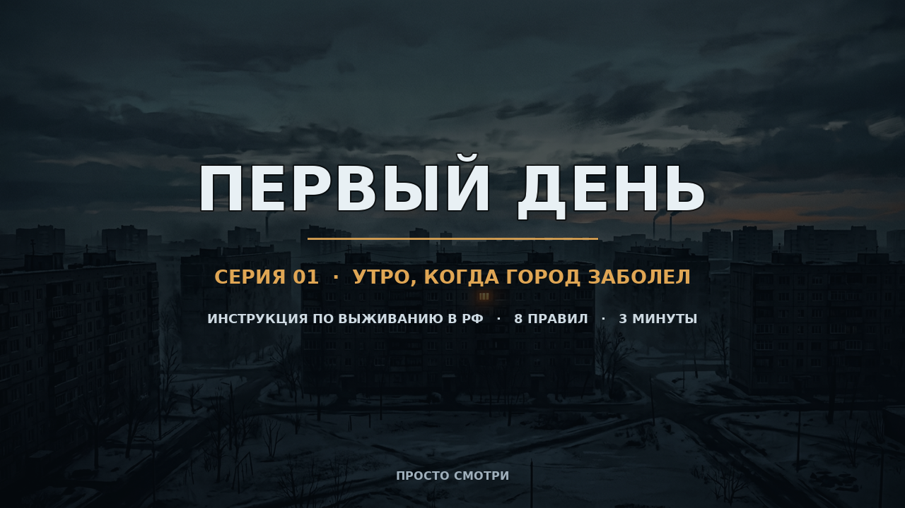
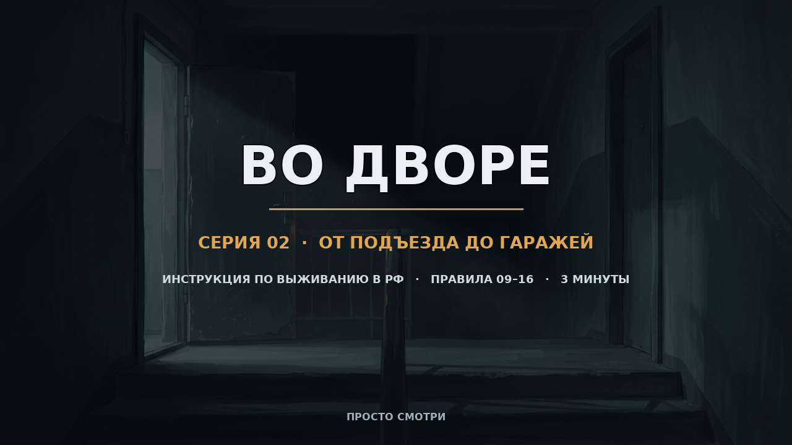

# ПЕРВЫЙ ДЕНЬ — Серия 01

Трёхминутный эпизод сериала-инструкции по выживанию в зомби-апокалипсисе в России.

Ты просыпаешься в 7:12 в квартире на пятом этаже обычной хрущёвки: за окном сирена, телефон без сети, в подъезде кто-то скребётся. Дальше — восемь правил, от «не открывай дверь» до «спускайся по лестнице на рассвете». Финал — клиффхэнгер на выходе во двор.

**Это просто видео.** Открыл и смотришь: никаких кликов, выборов и игровых механик.

## Файлы

| Файл | Что это |
| --- | --- |
| [`episode_01_first_day.mp4`](episode_01_first_day.mp4) | **Готовый эпизод.** 03:00, 1280×720, 25 fps, H.264 + AAC 192 kbps, ~20 МБ |
| [`episode_01_cover.png`](episode_01_cover.png) | Обложка серии |
| [`episode_script.md`](episode_script.md) | Полный текст озвучки, список звуков и таблица QC |
| [`build_episode.py`](build_episode.py) | Исходник сборки: таймлайн, типографика, Ken Burns, саунд-дизайн, мультиплекс и проверки |

## Как смотреть

Открой `episode_01_first_day.mp4` в этом репозитории — GitHub покажет встроенный видеоплеер. Или скачай файл и смотри в любом плеере.

Прямая ссылка на ветку:
`https://github.com/Korimuspast1/frd/blob/arena/37d19b94-frd/episode_01_first_day.mp4`

## Сделано и проверено

- **Ровно 180.00 с**, видео и аудио совпадают покадрово (4500 кадров при 25 fps).
- **14 планов**, плавное движение камеры, короткие затемнения на стыках сцен, заставка и финальная карточка.
- **49 субтитров**, все отцентрированы с отклонением ≤ 1 px, без поворотов. Номер правила, заголовок сцены, логотип серии и шкала прогресса вынесены в отдельный статичный слой — не смещаются при зуме.
- **SAR 1:1 / DAR 16:9**, вертикали и горизонтали без наклона; все объекты и надписи стоят ровно.
- **Звук**: постоянный гул и ветер, сирены, скрежет и удары в дверь, звон стекла, вода, щелчок газового крана, радиопомехи, сердцебиение, шаги, скрип двери, tension-riser'ы. Два голоса — рассказчик и диктор радио МЧС (обработан полосовым фильтром с помехами).
- **Уровни**: −16 LUFS (двухпроходный линейный loudnorm, без «накачки» тишины), peak −2.1 dB, голос громче фонов на +9.4 dB, клиппинга нет.
- Полный decode без ошибок.

## Воспроизведение сборки

`build_episode.py` — рабочий продакшн-скрипт, но ему нужны сгенерированные исходники в папке `render/`: 13 иллюстраций (`img*.png`) и 10 MP3-фрагментов озвучки (`vo_*.mp3`). Эти AI-ассеты намеренно не коммитятся (они большие и пересоздаются генераторами), поэтому в репозитории лежит уже готовый результат.

Зависимости: Python 3.11 + `pillow`, `numpy`, `imageio-ffmpeg`, `matplotlib` (шрифт DejaVu Sans для кириллицы). Запуск: `python build_episode.py`. Скрипт сам считает хронометраж, подгоняет темп речи под 3 минуты, рисует титры, сводит звук, собирает MP4 и пишет отчёт `render/qc_report.json` с контактным листом кадров `render/qc_contact_sheet.png`.

---

# Серия 02 — «ВО ДВОРЕ»

Продолжение: выход из подъезда, двор, гаражи и правила 09–16. От разведки перед выходом до сигнала СОС и живого голоса в эфире. Клиффхэнгер — спуск в подвал.

| Файл | Что это |
| --- | --- |
| [`episode_02_courtyard.mp4`](episode_02_courtyard.mp4) | **Готовый эпизод.** 03:00, 1280×720, 25 fps, H.264 + AAC 192 kbps, ~24 МБ |
| [`episode_02_cover.png`](episode_02_cover.png) | Обложка серии |
| [`episode_script_02.md`](episode_script_02.md) | Полный текст, таймкоды глав, таблица QC |
| [`build_episode_02.py`](build_episode_02.py) | Конфиг выпуска на общем движке `build_episode.py` |

**Главы:** 0:00 заставка · 0:04 правило 09 · 0:24 правило 10 · 0:42 правило 11 · 1:00 правило 12 (двор, эфир МЧС) · 1:36 правило 13 · 1:54 правило 14 · 2:13 правило 15 · 2:33 правило 16 · 2:55 финал.

QC серии 02: 180.00 с, 15 планов, 45 выровненных субтитров, голос выше фонов на +8.7 dB, peak −2.4 dB, decode без ошибок.

Запуск второй серии: `python build_episode_02.py` (использует ассеты в `render2/`, которые, как и `render/`, в коммит не входят).
