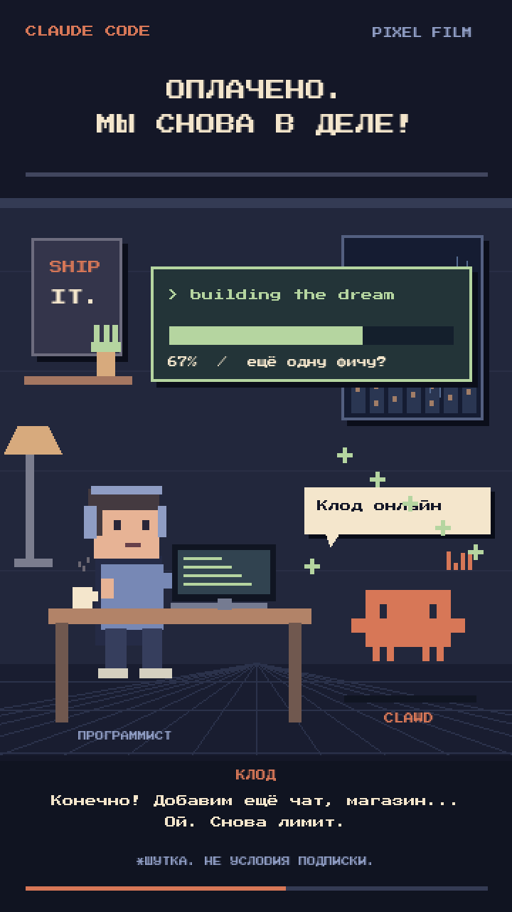
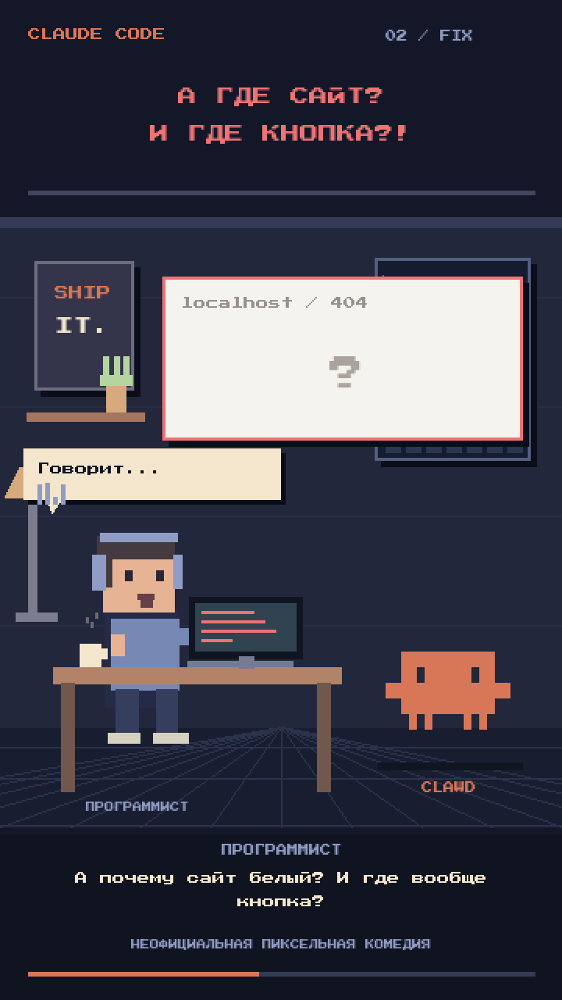
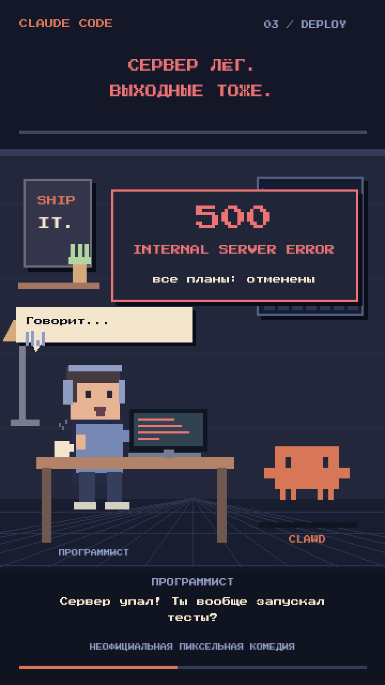
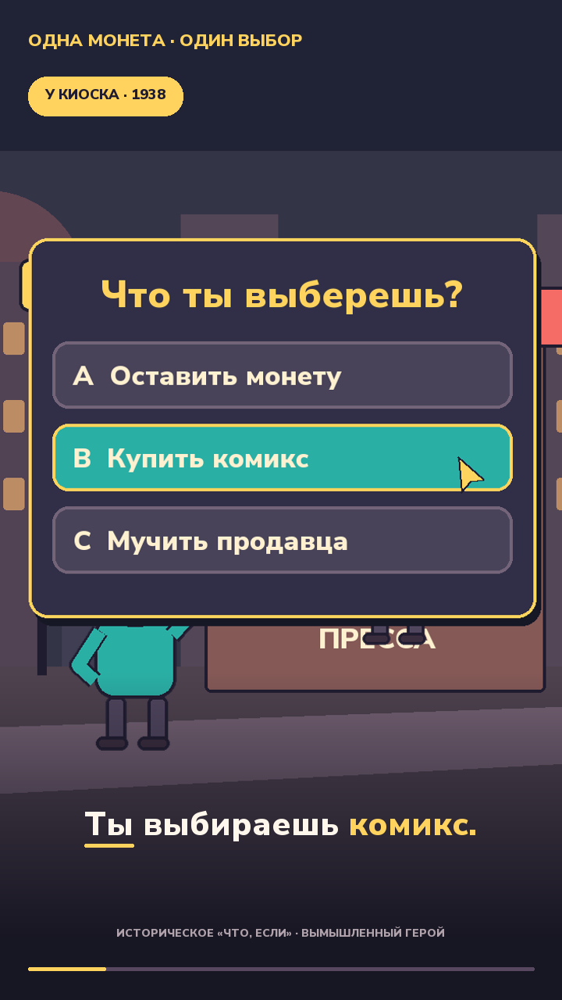
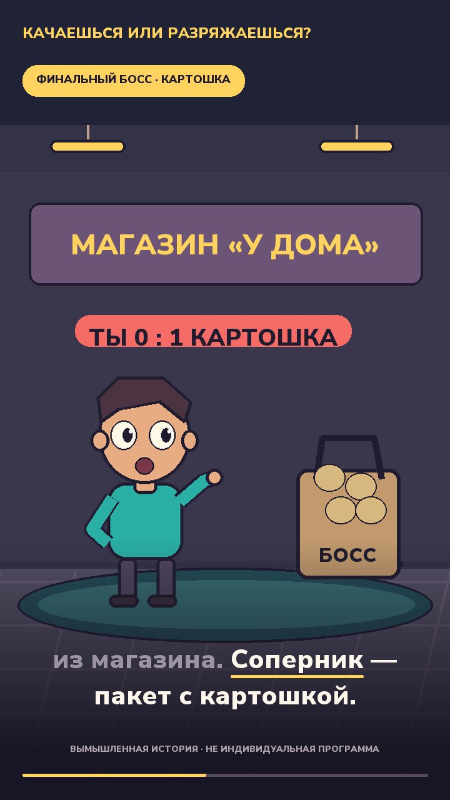
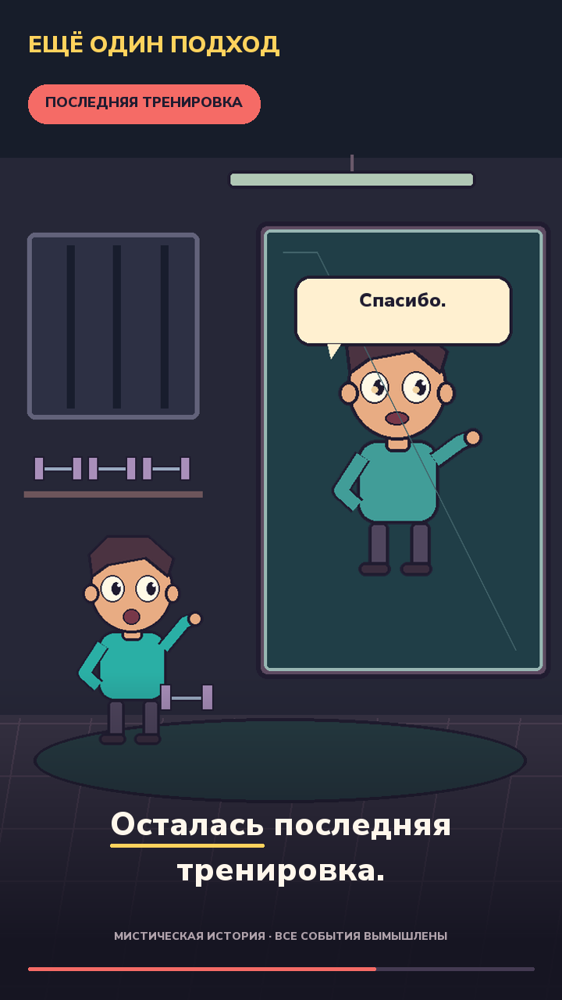
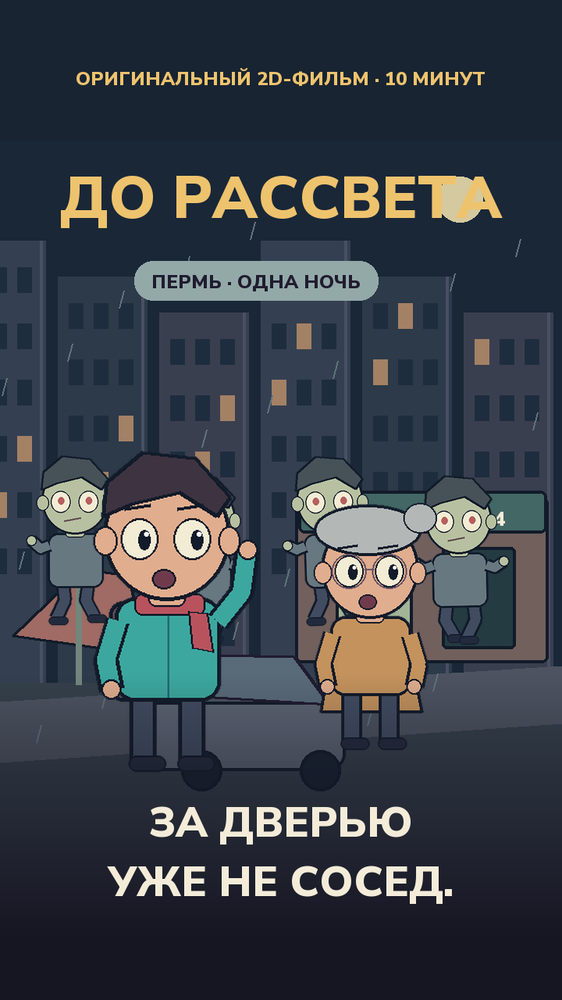
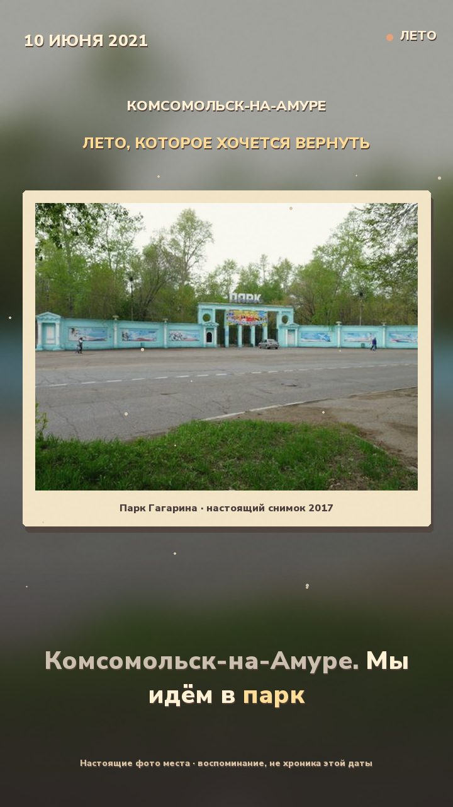

# Claude Code — «Купил надежду»

Неофициальная юмористическая пиксельная анимация: программист и Clawd,
покупка подписки, короткий прилив продуктивности и новый лимит.

## Смотреть

[](exports/claude-code-pixel-40s-voiced.mp4)

- **[Видео со встроенным звуком — MP4](exports/claude-code-pixel-40s-voiced.mp4)**
- [Полная звуковая дорожка отдельно — MP3](exports/soundtrack-40s-voiced.mp3)
- 40 секунд, 720 × 1280, 9:16, 30 fps.
- H.264 / AAC, стерео, faststart.

## Полная переработка

Вместо выдуманного круглого маскота используется силуэт **Clawd** из
официального терминального приветствия Claude Code. Блочные символы
переведены в пиксельную маску с сохранением четырёх ножек, глаз,
пропорций терминальных ячеек и терракотового цвета `#d77757`.
[Источник и описание референса](assets/clawd-reference.txt).

Новая сцена — комната с дождливым окном, рабочим столом, программистом и
Clawd рядом. В кадре анимированы набор текста, пар от кружки, дождь,
персонаж, курсор оплаты, конфетти и ход сборки проекта. Русские субтитры и два разных синтезированных голоса озвучивают диалог.
Восемь реплик распределены по таймлайну без пересечений; музыка и эффекты
автоматически становятся тише во время речи.

- [Субтитры SRT](exports/dialogue-40s.srt)
- [Тайминг реплик JSON](exports/dialogue-40s.json)
- Исходные выбранные голоса сохранены в `assets/voices/`.
- [Предыдущая версия, 25 секунд без озвучки](exports/claude-code-pixel-25s.mp4).

## Звук

Звук **уже встроен в MP4**, его не нужно добавлять отдельно.
Музыка и эффекты синтезируются кодом, без скачанных аудиосэмплов:

- оригинальная чиптюн-мелодия, бас и ударные;
- клавиши механической клавиатуры и щелчки мыши;
- каскад монет при оплате (16,75 с);
- звук ускорения (18 с);
- сигнал лимита и нисходящее выключение (9,5 и 27 с);
- финальный джингл и синтетическое посапывание.

## Повторная генерация

```bash
python -m venv .venv
.venv/bin/pip install -r requirements.txt
.venv/bin/python tools/make_video.py
.venv/bin/python tools/check_video.py
```

FFmpeg поставляется через `imageio-ffmpeg`. Исходная озвучка включена в репозиторий; повторный рендер не требует API озвучки.
Рендер детерминированный;
временный WAV не включается в Git. Шрифт Press Start 2P распространяется
по SIL OFL, текст лицензии находится в `assets/FONT-LICENSE.txt`.

Персонаж и название Claude принадлежат соответствующим правообладателям.
Ролик не является официальной рекламой; реплики о лимитах — шутка,
а не описание условий подписки. Файлы MP4 и EXE в корне репозитория
существовали до этой работы и не используются при генерации.

## Ещё два ролика — по 25 секунд

### 02. «Одна маленькая правка»

Программист просит сделать кнопку зелёной. Clawd заодно «улучшает
архитектуру», после чего сайт исчезает. Спасает откат.

[](exports/one-small-fix-25s.mp4)

**[Смотреть / скачать MP4](exports/one-small-fix-25s.mp4)** ·
[Субтитры SRT](exports/one-small-fix-25s.srt)

### 03. «Деплой в пятницу»

Быстрый релиз перед выходными. Локально всё хорошо, сервер падает,
а тесты оказались мысленными. Как и выходные.

[](exports/friday-deploy-25s.mp4)

**[Смотреть / скачать MP4](exports/friday-deploy-25s.mp4)** ·
[Субтитры SRT](exports/friday-deploy-25s.srt)

Оба видео: 25 секунд, 720×1280, 30 fps, H.264 / AAC stereo.
В каждом пять новых реплик, озвученных теми же двумя выбранными голосами,
русские субтитры, новая синтезированная мелодия и синхронные эффекты.
Музыка приглушается на время речи. Озвучка уже встроена в MP4;
исходные десять аудиоклипов лежат в `assets/voices/`.

Повторная генерация и проверка двух новых роликов:

```bash
.venv/bin/python tools/make_series.py
.venv/bin/python tools/check_series.py
```

## Исторический мультфильм · «Десять центов. И одна свободная полка»

**[Смотреть готовое видео — 2:10](exports/history/ten-cents-history-ru.mp4)** ·
**[Полный сценарий с таймкодами, описаниями сцен и источниками](exports/history/script-ru.md)** ·
[Субтитры SRT](exports/history/captions.srt) ·
[Пословный монтажный таймлайн JSON](exports/history/timeline.json)

[](exports/history/ten-cents-history-ru.mp4)

Оригинальная история на русском, от второго лица. Тебе 17, на дворе 1938
год, в кармане десять центов. Ты покупаешь первый выпуск Action Comics,
читаешь, мнёшь и в итоге освобождаешь полку. Затем рассказ переходит к
реальной продаже другого экземпляра за $6 млн на Heritage 4 апреля 2024.

Герой, его родственники и бытовые события вымышлены; выпуск, первоначальная
цена и аукционная продажа реальны. В самом видео это ясно разделено.
Оценка CGC 8,5 относится к проданному экземпляру. Отношение ценников
×60 млн не выдается за инвестиционную доходность или обещание цены.
Финальный тизер — Inverted Jenny, марка с перевёрнутым самолётом.

Новая визуальная стилистика: плоская 2D-рисовка с контурами, тёплые цвета,
четыре персонажа, интерьеры и реквизит 1930-х, смена планов каждые 2–4 с,
жесты, моргание, параллакс, наезды, затемнение под пословными титрами.
Озвучка выбранным русским рассказчиком, оригинальная музыка и эффекты уже
встроены в MP4. Пословные метки оценочные: фонетические веса + паузы в речи,
без ручной фонемной разметки; сохранены для дальнейшего редактирования.

```bash
.venv/bin/python tools/make_history.py
.venv/bin/python tools/check_history.py
```

Источники текста, аудио и шрифт Nunito Sans с OFL находятся в
`assets/history/`. Исходные голосовые файлы включены, поэтому для повторного
рендера не нужен сервис озвучки. Промежуточный WAV и кадры проверки
не отслеживаются Git. Итог — H.264/AAC, 720×1280, 30 fps, faststart.

## «Тренируешься больше. Сил всё меньше» · 1:37

**[Смотреть / скачать видео](exports/training/training-but-weaker-ru.mp4)** ·
[Полный сценарий с таймкодами](exports/training/script-ru.md) ·
[Субтитры](exports/training/captions.srt) ·
[Монтажный таймлайн](exports/training/timeline.json)

[](exports/training/training-but-weaker-ru.mp4)

Новая современная 2D-история: герой игнорирует усталость и отдых, получает
похвалу от приложения, но проигрывает пакету картошки. Тренер объясняет,
почему нагрузка — только часть процесса, и герой пересматривает план.

97,30 секунды, 720×1280, 30 fps, H.264/AAC stereo. Семь новых озвученных
фрагментов выбранным рассказчиком, музыка, эффекты, пословные титры,
анимированные отжимания и гантели, выбор A/B/C, друг и тренер.

Это вымышленная комедия о возможном накоплении усталости при недостаточном
восстановлении. Цифры повторений и батарейка условны. Она не утверждает,
что занятия спортом сами по себе ослабляют, не ставит диагноз и не обещает
восстановления за одну ночь. В финале — рекомендация обратиться к врачу
при стойкой или неожиданной слабости. Источник общего объяснения и
ограничения: `assets/training/sources.md` и конец полного сценария.

```bash
.venv/bin/python tools/make_training.py
.venv/bin/python tools/check_training.py
```

Исходные WAV находятся в `assets/training/voice/`; повторная генерация
не требует API озвучки. Общая библиотека векторных персонажей, шрифт
Nunito Sans (OFL) и аудиомонтаж переиспользованы из исторического ролика.

## Мистическая версия · «Ещё один подход» · 1:42

**[Готовый мультфильм](exports/mirror/one-more-rep-mystery-ru.mp4)** ·
[Полный сценарий и планы по таймкодам](exports/mirror/script-ru.md) ·
[Субтитры SRT](exports/mirror/captions.srt) ·
[Пословный монтажный таймлайн](exports/mirror/timeline.json)

[](exports/mirror/one-more-rep-mystery-ru.mp4)

Это новая сверхъестественная история, а не медицинское объяснение прошлой.
Герой тренируется и необъяснимо слабеет. При этом его отражение становится
сильнее, продолжает подход после него и начинает действовать самостоятельно.
Финал: двойник оказывается снаружи, настоящий герой — внутри зеркала;
следующий абонемент уже выписан другу.

Холодная тёмная палитра, независимая анимация двойника, крупные планы стекла,
видеозапись с задержкой, ночная ванная, растущая трещина и переход сквозь зеркало.
Отдельно синтезированный тревожный эмбиент вместо комедийной музыки,
металлические удары, щелчок замка и стеклянный звук перехода. Новая озвучка
тем же выбранным рассказчиком, русские пословные титры. Без медицинских
объяснений, тренера или морали о восстановлении. Все события вымышлены.

101,80 с, 720×1280, 30 fps, H.264/AAC stereo. Видео уже содержит звук.

```bash
.venv/bin/python tools/make_mirror.py
.venv/bin/python tools/check_mirror.py
```

Новые исходные голосовые клипы: `assets/mirror/voice/`. Используются общие
векторные персонажи и шрифт Nunito Sans с лицензией SIL OFL из `assets/history/`.

## «ДО РАССВЕТА» · Ночь в Перми · 10:00

**[Готовый 10-минутный фильм](exports/survival/do-rassveta-10min-ru.mp4)** ·
[Полный сценарий с таймкодами и описанием 150 планов](exports/survival/script-ru.md) ·
[Субтитры SRT](exports/survival/captions.srt) ·
[Монтажный таймлайн JSON](exports/survival/timeline.json)

[](exports/survival/do-rassveta-10min-ru.mp4)

Оригинальная история выживания в вымышленном районе Перми. Ночью Антон
слышит стук в дверь, замечает зомби во дворе и пытается выбраться из дома.
Он помогает пожилой соседке Вере, объединяется с людьми из магазина и
ищет дорогу к автобусу. Никакой крови: напряжение строится на звуках,
ожидании, ошибочных маршрутах и решениях не бросать других.

| Время фильма | Глава |
|---|---|
| 00:00–01:00 | Кто-то у двери |
| 01:00–02:00 | Они слышат |
| 02:00–03:00 | Другой выход |
| 03:00–04:00 | Не оставлять своих |
| 04:00–05:00 | Вода в темноте |
| 05:00–06:00 | Четырнадцать метров |
| 06:00–07:00 | Витрина не выдержит |
| 07:00–08:00 | Быстрый путь — ловушка |
| 08:00–09:00 | Двигатель, пожалуйста |
| 09:00–10:00 | Дожить до рассвета |

**Формат:** ровно 600 секунд, 18 000 кадров, 720×1280 (9:16), 30 fps,
H.264/AAC stereo, faststart. 150 монтажных планов по 4 секунды, 111 типов
действий. Это не петля и не повтор короткого ролика. Движение персонажей,
дождь, камера, вода, свет и звуковые события рассчитываются для таймлайна.

**Постановка:** новый ансамбль — Антон в бирюзовой куртке и красном шарфе,
Вера в охристом пальто, продавщица, водитель в синей кепке, девочка в жёлтой
шапке. Зомби показаны без натуралистичных ран. Локации: квартира, лоджия,
лестница, затопленный подвал, двор панельных домов, магазин, крыша,
улица, салон автобуса и депо.

**Звук:** десять новых озвученных глав выбранным русским рассказчиком,
разделённых на 30 голосовых отрезков. Между ними — действие без рассказчика,
оригинальный тревожный музыкальный фон, шаги, вода, удары, сигнализация,
треск стекла, мотор и рация. Звук уже встроен. Пословные титры используют
оценочные фонетические метки с учётом голосовой активности; все метки
сохранены для редактирования. История и район вымышлены, реальных адресов
и утверждений о настоящем происшествии нет.

```bash
.venv/bin/python tools/make_survival.py
.venv/bin/python tools/check_survival.py
```

Исходники: `assets/survival/story.json`, русские описания планов
`assets/survival/shots-ru.json`, десять сжатых голосовых файлов в
`assets/survival/voice/`. Временные WAV и проверочные кадры не включаются
в Git. Графика и музыка оригинальные; шрифт Nunito Sans с SIL OFL
повторно используется из `assets/history/`.

## «Мне снова восемь» · 10 июня 2021 · 1:00

**[Готовый MP4 — ровно 60 секунд](exports/nostalgia/mne-snova-8-2021-komsomolsk.mp4)** ·
[Сценарий и таймкоды](exports/nostalgia/script-ru.md) ·
[Субтитры SRT](exports/nostalgia/captions.srt) ·
[Источники фото и ограничения](assets/nostalgia/sources.md)

[](exports/nostalgia/mne-snova-8-2021-komsomolsk.mp4)

Персональное летнее воспоминание от первого лица. Пользователь сообщил:
родился в 2013 году, в 2021 ему было восемь. В кадре **10 июня 2021**, а не
подростковый возраст из предыдущих историй. Утро, солнечная комната,
каникулы, парк Гагарина, паровозик, мороженое и просьба ещё погулять.

**Место настоящее:** вход и летние аллеи — непосредственно фотографии
парка Гагарина в Комсомольске-на-Амуре. Парк Судостроителей и фотографии
других городов исключены. Архитектура не заменена нейросетевой фантазией.
Это фото-монтаж с мягкими наездами, а не обещание документального видео
или точной 3D-копии парка на 10.06.2021. Найденные фото сняты раньше:
2016 (Алексей Карлин / «Фото городов») и 2017 (Центр ОПИК).
Даты источников и авторство указаны в самом ролике и в полном сценарии.
Правообладатели фотографий сохраняют свои права; атрибуция не означает
наличие открытой лицензии для коммерческой перепубликации.

Комната создана AI как обобщённый образ детского утра, не выдана за
настоящую квартиру пользователя. Руки, мороженое и качели — художественные
образы, лицо пользователя не моделируется. Фотографии низкого исходного
разрешения оформлены как домашние карточки; их детализация не выдумана.

Шесть новых реплик выбранным русским рассказчиком, включая «Я хочу обратно
в две тысячи двадцать первый» и «Мне восемь». Оригинальная мягкая мелодия,
звук птиц, воздух, шаги и скрип качелей синтезированы кодом; чужая песня
не использована. Звук уже встроен в MP4. Пословная подсветка оценочная,
по паузам и фонетическим весам. Финальный файл: 720×1280, 30 fps,
H.264/AAC stereo, faststart, 1800 кадров.

```bash
.venv/bin/python tools/make_nostalgia.py
.venv/bin/python tools/check_nostalgia.py
```

Исходники: `assets/nostalgia/`. Шрифт Nunito Sans (SIL OFL) повторно
использован из `assets/history/`. Промежуточные кадры и WAV саундтрека
не отслеживаются Git.
