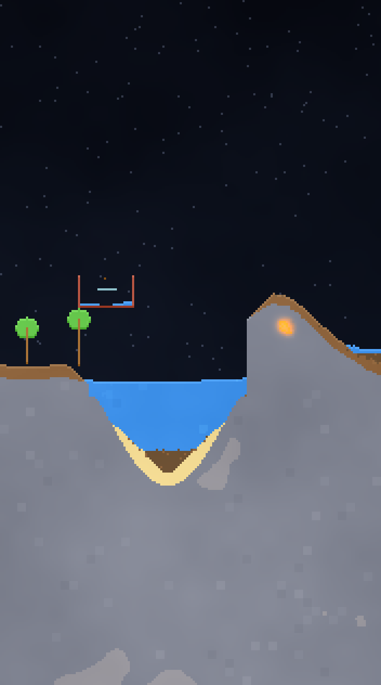

# Песочница (Sandbox)

Пиксельная физическая песочница для Android в духе WorldBox / The Powder Toy: ставишь материалы пальцем, а игра сама считает гравитацию, текучесть, тепло и химические реакции.



## Что умеет

**28 материалов**
- Сыпучие: песок, земля, гравий, соль, снег, пепел, семена, порох
- Твёрдые: камень, дерево, металл, стекло, обсидиан, кристалл, кирпич, лёд, растение
- Жидкости: вода, солёная вода, нефть, кислота, лава, грязь, расплавы металла и стекла
- Газы и огонь: пар, дым, пламя

**Физика**
- Клеточный автомат с разными типами частиц: порошки скатываются под углом, жидкости растекаются и выравнивают уровень, газы поднимаются, тяжёлое тонет в лёгком (нефть плавает на воде, камень тонет)
- Поле температуры: теплопроводность, теплоёмкость, нагрев и остывание, плавление и кипение
- Огонь держится за топливо, поджигает соседей и оставляет пепел и дым

**Реакции (игра считает их сама)**
| Что смешать | Что получится |
|---|---|
| Вода + лава | камень + пар (иногда обсидиан) |
| Песок + лава | стекло |
| Земля + лава | кирпич |
| Металл + лава | расплав металла |
| Земля + вода | грязь |
| Соль + вода | солёная вода |
| Вода + мороз | лёд |
| Лёд/снег + огонь или лава | вода |
| Пар + холод | конденсат |
| Дерево + огонь | пепел, дым, пламя |
| Порох + огонь | взрыв |
| Кислота + материал | дым и пустота |
| Семена + земля + вода | растение (растёт вверх) |
| Пепел + вода | ил |
| Камень + холодная вода | кристалл |

Открытые комбинации сохраняются в «Книгу реакций» — она открывается по иконке колбы сверху.

## Управление

- **Тап / свайп по экрану** — ставить выбранный материал
- **Панель снизу** — категории (Земля / Вода / Огонь / Жизнь / Блоки) и клетки материалов
- **Фикс** — закрепить блок: он не падает (камень, висящие конструкции)
- **Ластик** — стирать
- **Ползунок** — размер кисти 1–14
- **Пауза** — остановить физику, чтобы построить
- **Шестерёнка** — новый мир (остров, вулкан, пустыня, ледник, пустой), сохранение и загрузка

## Структура

```
sandbox/
├─ app/src/main/assets/
│  ├─ index.html          интерфейс: панель материалов, HUD, модалки
│  ├─ js/materials.js     таблица материалов, свойства, книга рецептов
│  ├─ js/world.js         движок: клеточный автомат, тепло, реакции, генерация мира
│  ├─ js/pixel.js         рендер пикселей в RGBA + карта свечения
│  └─ js/app.js           ввод, кисть, панель, модалки, игровой цикл
├─ app/src/main/java/.../MainActivity.java   WebView-обёртка, портрет, офлайн
├─ previews/              сгенерированные превью сцен
└─ .github/workflows/sandbox-apk.yml (в корне репозитория) — сборка APK
```

## Сборка

Локально (нужны JDK 17+ и Android SDK):

```bash
cd sandbox
./gradlew :app:assembleRelease
```

APK появится в `app/build/outputs/apk/release/`.

В репозитории APK собирается автоматически через GitHub Actions на каждый пуш в `sandbox/**` и прикрепляется к релизу. Готовый файл также лежит в `out/sandbox.apk`.

## Технические детали

- Мир — сетка до ~62 000 клеток, шаг симуляции 60 Гц, рендер через `ImageData` + `putImageData` без сглаживания
- Свечение лавы и огня — отдельный буфер со `blur` в режиме `lighter`
- Тепло хранится в `Float32Array`, материалы/флаги — `Uint8Array` (кэш-дружелюбно для телефона)
- Сохранение мира — RLE-упаковка в base64 в `localStorage`
